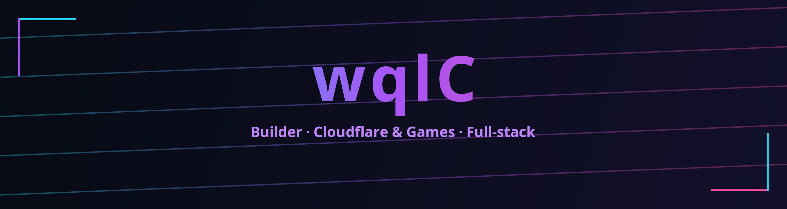

  

  

  

### 简介 / About

- 独立构建者，热爱把想法落地成可用的产品与工具  
- 关注 Cloudflare Workers、边缘计算、小型/休闲游戏与自动化工作流  
- 偏爱强类型 + 简洁工程实践：TypeScript / Python / Java  
- 技术即画笔，项目是霓虹色的像素点

  

### 精选项目 / Featured

  <!-- row 1 -->
  
  
   

  <!-- row 2 -->
  
  
   

  <!-- row 3 -->
  

> 其他：  
> - ziwei-cloudflare —— Cloudflare / 紫微（研究/原型，未开源）  
> - funplay-games —— 休闲小游戏合集（未开源）  
> - recoil-minigame、timing-tap-minigame —— 微信/抖音小游戏原型（未开源）

  

### 技术栈 / Tech Stack

  
  
  
  
  
  

  

### 统计 / Metrics

  
  
   
  

  

### 联系 / Links

- GitHub: [@wqlC](https://github.com/wqlC)

暗色 / 霓虹 / cyberpunk · SVG + badges · 低负载、纯静态渲染

<!--
**wqlC/wqlC** is a ✨ _special_ ✨ repository because its `README.md` (this file) appears on your GitHub profile.

Here are some ideas to get you started:

- 🔭 I’m currently working on ...
- 🌱 I’m currently learning ...
- 👯 I’m looking to collaborate on ...
- 🤔 I’m looking for help with ...
- 💬 Ask me about ...
- 📫 How to reach me: ...
- 😄 Pronouns: ...
- ⚡ Fun fact: ...
-->
